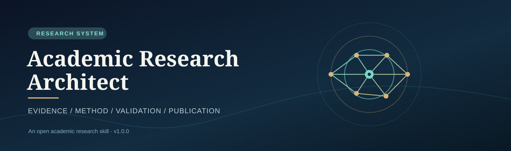
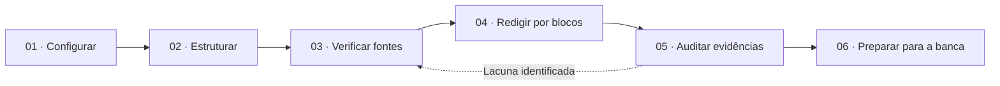

<div align="center">



<br>

# Academic Research Architect

**Planeje com método. Escreva com evidências. Publique com rigor.**

Uma **Agent Skill aberta** para planejar, redigir por etapas e auditar dissertações, capítulos, RSL/MSL e artigos científicos. O pesquisador define a estrutura, a metodologia e as normas; o assistente organiza o fluxo e explicita o que ainda não foi comprovado.

[](academic-research-architect/SKILL.md)
[](LICENSE)
[](docs/claude-install.md)
[](CHANGELOG.md)

[**Começar**](#-comece-em-3-passos) · [**Configurador visual**](docs/index.html) · [**Instalar no Claude**](docs/claude-install.md) · [**Metodologia**](docs/methodological-rigor.md) · [**Exemplos**](docs/use-cases.md)

</div>

---

## O que esta skill resolve

A maioria dos prompts acadêmicos mistura escopo, sumário, método e formatação como se fossem a mesma coisa. Não são. O **Academic Research Architect** separa essas decisões e impõe um fluxo de produção verificável, evitando bibliografias inventadas, resultados simulados apresentados como reais e dissertações escritas em um único bloco.

| Selecione | Opções |
|:--|:--|
| **Produção** | Dissertação por etapas · Capítulo · Seção · RSL/MSL · Artigo · Revisão crítica |
| **Estrutura** | OSINT (6 capítulos) · Tradicional · IMRaD · Baseada em artigos · Institucional · Personalizada · Livre |
| **Norma editorial** | Institucional · IEEE SMC 2025 · IEEE Conference/Journal · ABNT · APA · Híbrida |
| **Citações** | IEEE · ABNT · APA |
| **Método** | Experimental · Qualitativo · Quantitativo · Misto · DSR · Estudo de caso · RSL/MSL |
| **Tema** | Livre. OSINT/CTI é **apenas uma opção**, não um requisito. |

### O motor acadêmico



## 🚀 Comece em 3 passos

1. **Instale a skill** no [Claude.ai ou Claude Code](docs/claude-install.md).
2. **Preencha o [painel acadêmico](academic-research-architect/assets/configuration.md)** ou use o [configurador web](docs/index.html) (local, sem transmitir dados).
3. Peça: **“Use academic-research-architect. Analise minha configuração e proponha um plano; não invente referências.”**

> **Nota:** para abrir o configurador como site público, é necessário ativar manualmente o GitHub Pages com a fonte **main /docs**. O arquivo HTML já está incluído; o deploy não é automático.

### Exemplo de chamada

```text
Use a skill academic-research-architect.
Escopo: capítulo específico (Capítulo 3).
Estrutura: OSINT de 6 capítulos.
Metodologia: mapeamento sistemático.
Norma editorial: institucional. Citações: IEEE.
Tarefa: planeje o protocolo, questões de pesquisa,
critérios de seleção e strings de busca.
Não alegue ter executado buscas nem invente contagens.
```

## 📦 Estrutura do projeto

```text
academic-research-architect/
├── README.md                       # Apresentação e navegação
├── academic-research-architect/     # PASTA INSTALÁVEL DA SKILL
│   ├── SKILL.md                     # Agente + roteamento
│   ├── references/                  # Metodologia e normas sob demanda
│   │   ├── academic-core.md
│   │   ├── structures.md
│   │   ├── editorial.md
│   │   ├── evidence.md
│   │   ├── methodology.md
│   │   └── quality-review.md
│   └── assets/                      # Formulários e planilhas-base
│       ├── configuration.md
│       ├── evidence-ledger.csv
│       └── traceability-matrix.csv
├── docs/
│   ├── index.html                   # Interface visual estática
│   ├── claude-install.md
│   ├── how-it-works.md
│   ├── methodological-rigor.md
│   ├── publishing.md
│   └── use-cases.md
├── examples/                        # Exemplos sem resultados fictícios
├── scripts/                         # Validação e empacotamento
├── .github/workflows/validate.yml  # Checagens automatizadas
└── assets/academic-banner.svg       # Identidade visual
```

## Princípios inegociáveis

**Sem fontes fictícias.** Toda referência tem estado (verificada, fornecida ou pendente). **Sem falsa revisão sistemática.** Protocolo planejado não equivale a busca executada. **Sem conclusão antecipada.** Resultados esperados não são resultados observados. **Sem formatação improvisada.** Regras IEEE de conferência não substituem normas de dissertação. **Sem autoria terceirizada invisível.** O pesquisador valida e assume suas decisões intelectuais.

## Guias e exemplos

- [Como funciona e quando usar](docs/how-it-works.md)
- [Instalação Claude.ai / Claude Code](docs/claude-install.md)
- [Rigor científico, evidências e RSL/MSL](docs/methodological-rigor.md)
- [Distribuição pública, licença e GitHub Pages](docs/publishing.md)
- [Casos de uso e comandos](docs/use-cases.md)
- [Exemplo de dissertação OSINT](examples/osint-dissertation.md)
- [Exemplo de artigo IEEE](examples/ieee-conference-paper.md)
- [Exemplo de capítulo individual](examples/single-chapter.md)

## Referências oficiais

- [Anthropic — Criar skills personalizadas](https://support.claude.com/pt/articles/12512198-como-criar-habilidades-personalizadas)
- [Anthropic — Usar skills no Claude](https://support.claude.com/pt/articles/12512180-usar-skills-no-claude)
- [Agent Skills — especificação](https://agentskills.io/specification)
- [IEEE SMC 2025 — Call for Papers](https://www.ieeesmc2025.org/call-for-papers.html)
- [IEEE Author Center — templates](https://conferences.ieeeauthorcenter.ieee.org/write-your-paper/authoring-tools-and-templates/)

> Este projeto é uma ferramenta de apoio acadêmico independente. Não é afiliado, endossado ou certificado pela Anthropic ou IEEE. As regras institucionais e as políticas editoriais vigentes prevalecem.

## Contribua

Veja [CONTRIBUTING.md](CONTRIBUTING.md), [SECURITY.md](SECURITY.md) e [LICENSE](LICENSE). Sugestões de novos modelos e correções de normas são bem-vindas quando acompanhadas de fonte oficial.

<div align="center"><sub>Academic Research Architect · Evidence first, always.</sub></div>
